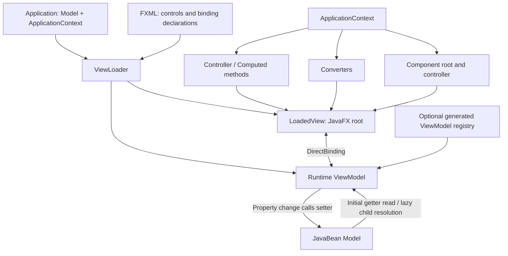

# Architecture and lifetime

## Model, View and ViewModel

The Model is an ordinary JavaBean representing application data. A View is an FXML document and its JavaFX controls. The ViewModel makes Model Attributes observable and writes changes back to the bean. This is the separation behind Model–View–ViewModel (MVVM): controls depend on observable presentation state rather than carrying persistence or business logic themselves.

NeitzelLib creates that presentation layer at runtime. You can subclass it for additional properties, choose a replacement object, or generate typed Java accessors. None of these choices generates a controller automatically. A controller remains an optional, application-written object for event handlers, Computed methods and screen behavior. A Component combines a reusable JavaFX root, its own FXML, and a Model property.

For the person desk, `Person` is the Model, `Desk.fxml` the View, `PersonViewModel` adds `title`, and `DeskController` handles buttons and calculates the greeting. `AddressForm` renders an Address, `VisitRow` renders a Table row, and converters adapt model values to editable text. The [example walkthrough](../../fx-example/README.md) connects these files to visible behavior.

The [dependency baseline](../README.md#dependencies) distinguishes application runtime dependencies from optional build and Designer tooling.

## Loading order

`ViewLoader.load` reads the controller declaration and its ViewModel selection, obtains or creates the Model's ViewModel, then loads FXML. The injection context supplies controllers, Components and Converters. JavaFX performs normal `@FXML` field injection and calls `initialize`. After loading, the library supplies the ViewModel to `HasViewModel` only when the selected object extends `ViewModel` (replacement objects do not receive this callback), applies BindingLists in document order, and opens custom Tables.

Consequently, `initialize` must not assume that `HasViewModel.setViewModel` has already run. A Component's own bindings wait for its first non-null Model. Binding order can matter when an earlier declaration causes a nested Model's ViewModel to be created before a later Component requests a more specific class.

`LoadedView` exposes the root, named properties and the runtime ViewModel. `getViewModel()` returns the generic `ViewModel` or its subclass and throws `IllegalStateException` for a replacement that does not extend it. `property(name)` also supports a replacement exposing named JavaFX properties and returns null for an unknown name. A plain `FXMLLoader` does not apply NeitzelLib's binding declarations or DI integration.

## Observability and identity

Attributes are JavaBeans properties with both a getter and setter. Runtime properties are initialized from the bean and changes to them call its setter. Direct calls to a bean setter do not send notifications back to the runtime property. Update the ViewModel on the JavaFX application thread when application logic should update an existing View.

The runtime holds a **global, strong, identity-based cache** of Model-to-ViewModel associations. The same Model object shares one ViewModel across Views and contexts; equal but distinct beans do not. Registration before traversing children supports cyclic graphs. There is no public eviction or release API. Treat this as an explicit limitation for applications with many short-lived Models.

Complex Attributes are mapped lazily to nested ViewModels. A null child stays null. A dotted binding resolves intermediate objects when the binding is applied; it does not dynamically reattach after replacing an intermediate child. Bind a Component's `model` to the complex Attribute when you want a subform, but note that the current Component implementation also applies its internal bindings only for its first non-null Model.

Lists are shared ObservableLists when possible. A `List` bean setter generally accepts the observable wrapper; a concrete collection setter may not. Non-List collections are copied. Initialize collections before loading, and mutate the observable list exposed by the loaded Model/ViewModel, not an old non-observable backing reference. Replacing a bean's collection with its setter does not update an already loaded ViewModel. Repeat and Table handle add/remove and `set(index, replacement)` notifications, but ignore permutations and extractor update notifications.

## Context and View lifetime

The [injection context](../../injection/README.md) caches one instance of every scanned class. This includes controllers and converters. Reusing a controller in multiple live Views overwrites its injected FXML fields. Components reuse the context instance for the first occurrence of a class in a load and create fresh instances for additional occurrences; Repeat and Table explicitly create fresh row roots. Nested Components still need care when the same context is reused across independent loads.

Use a separate context for independent windows unless shared controller/component lifetime is intentional. This does not isolate the global Model identity cache: use separate Model instances if you need independent drafts.

There is no general `LoadedView.close()`, ViewModel disposal, unbind-all operation, or container shutdown hook. Bindings, collection listeners and MessagePopup listeners can retain objects. Closing a Stage does not constitute a documented cleanup contract for these listeners. Install popup listeners once, keep application lifetimes bounded, and test long-running/repeated-window workloads before depending on this snapshot.

Run loading, scene changes, observable property updates and message operations on the JavaFX application thread. The context and ViewModel cache are not concurrent services. Perform slow I/O separately and deliver results with `Platform.runLater`; do not perform it inside Computed methods or property listeners.

## Modules and reflection

The library artifacts currently act as automatic modules named `fx` and `injection`. An application using JPMS generally needs `requires fx`, `requires injection`, `requires jakarta.inject`, `requires javafx.controls` and `requires javafx.fxml`. The precise requirements depend on its imports.

Open bean packages to `fx` for reflective Attribute access. FXML controller and Component packages need reflective access for JavaFX and the library/container; an unqualified `opens your.controls;` is a straightforward starting point while diagnosing a modular application. Injection may invoke non-public constructors and members. Generated ViewModel packages also require suitable exports/opens, and a named-module registry uses `provides de.neitzel.fx.view.ViewModelRegistry with ...` rather than only a classpath service file.

Package scanning depends on the runtime's class/module paths. Verify the real modular launch; success on the classpath does not prove a module configuration is correct. The Designer separately validates classpath and module-path target applications and keeps its Kit runtime distinct from the application's JavaFX runtime.

## Choosing extensions

Start with generic runtime properties. Add a ViewModel subclass for derived presentation state and a controller for event handling. Use [generated ViewModels](generated-viewmodels.md) for typed access and shared discovery metadata. Use [Components, Repeat and Table](../README.md#component) to reuse form structure. The Designer is an optional authoring tool: the application remains runnable without it.

The library is a development snapshot and a personal helper collection. In particular, it is not a transactional form engine, a virtualized table, a dependency-tracking expression language, or a full dependency injection framework. Keep business validation and persistence boundaries explicit in application code.
