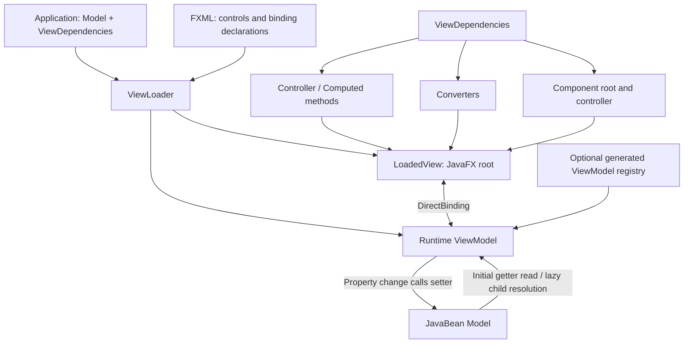

# Architecture and lifetime

## Model, View and ViewModel

The Model is an ordinary JavaBean representing application data. A View is an FXML document and its JavaFX controls. The ViewModel makes Model Attributes observable and writes changes back to the bean. This is the separation behind Model–View–ViewModel (MVVM): controls depend on observable presentation state rather than carrying persistence or business logic themselves.

NeitzelLib creates that presentation layer at runtime. You can subclass it for additional properties, choose a replacement object, or generate typed Java accessors. None of these choices generates a controller automatically. A controller remains an optional, application-written object for event handlers, Computed methods and screen behavior. A Component combines a reusable JavaFX root, its own FXML, and a Model property.

For the person desk, `Person` is the Model, `Desk.fxml` the View, `PersonViewModel` adds `title`, and `DeskController` handles buttons and calculates the greeting. `AddressForm` renders an Address, `VisitRow` renders a Table row, and converters adapt model values to editable text. The [example walkthrough](../../fx-example/README.md) connects these files to visible behavior.

The [dependency baseline](../README.md#dependencies) distinguishes application runtime dependencies from optional build and Designer tooling.

## Loading order

`ViewLoader.loadWithDependencies` reads the controller declaration and its ViewModel selection, obtains or creates the Model's ViewModel, then loads FXML. The adapter supplies controllers, Components and Converters. JavaFX performs normal `@FXML` field injection and calls `initialize`. After loading, the library supplies the ViewModel to `HasViewModel` only when the selected object extends `ViewModel` (replacement objects do not receive this callback), applies BindingLists in document order, and opens custom Tables.

Consequently, `initialize` must not assume that `HasViewModel.setViewModel` has already run. A Component's own bindings wait for its first non-null Model. Binding order can matter when an earlier declaration causes a nested Model's ViewModel to be created before a later Component requests a more specific class.

`LoadedView` exposes the root, named properties and the runtime ViewModel. `getViewModel()` returns the generic `ViewModel` or its subclass and throws `IllegalStateException` for a replacement that does not extend it. `property(name)` also supports a replacement exposing named JavaFX properties and returns null for an unknown name. A plain `FXMLLoader` does not apply NeitzelLib's binding declarations or DI integration.

## Observability and identity

Attributes are JavaBeans properties with both a getter and setter. Runtime properties are initialized from the bean and changes to them call its setter. Direct calls to a bean setter do not send notifications back to the runtime property. Update the ViewModel on the JavaFX application thread when application logic should update an existing View.

Each managed `ViewModelContext` stores Model-to-ViewModel associations
by object identity. Views in the same context can share the ViewModel
for the same Model object. Independent contexts have independent
registrations. Registration before traversing children supports cyclic graphs.
Closing the context releases its registrations and closes the remaining Views.

Complex Attributes are mapped lazily to nested ViewModels. A null child stays null. A dotted binding resolves intermediate objects when the binding is applied; it does not dynamically reattach after replacing an intermediate child. Bind a Component's `model` to the complex Attribute when you want a subform, but note that the current Component implementation also applies its internal bindings only for its first non-null Model.

Lists are shared ObservableLists when possible. A `List` bean setter generally accepts the observable wrapper; a concrete collection setter may not. Non-List collections are copied. Initialize collections before loading, and mutate the observable list exposed by the loaded Model/ViewModel, not an old non-observable backing reference. Replacing a bean's collection with its setter does not update an already loaded ViewModel. Repeat and Table handle add/remove and `set(index, replacement)` notifications, but ignore permutations and extractor update notifications.

## Context and View lifetime

Use one adapter for a container and give each logical window or document
a Model context. Related Views can share a Model context. Each View
receives fresh Controller and Component instances. Share services through
the adapter.

Close a `LoadedView` when it leaves the application. Its bindings and
listeners are detached, and the adapter's release actions run for its
Controller and child Components. Close the Model context when its owner
ends. Close the application-owned container after its Views. The optional
[Neitzel adapter](../../fx-injection/README.md) uses the existing
ApplicationContext lookup for shared services and fresh instances for the UI.

Run loading, scene changes, observable property updates and message operations on the JavaFX application thread. The context and ViewModel cache are not concurrent services. Perform slow I/O separately and deliver results with `Platform.runLater`; do not perform it inside Computed methods or property listeners.

## Modules and reflection

A named application using FX typically declares `requires fx`,
`requires javafx.controls` and `requires javafx.fxml`. An application
using the optional Neitzel adapter adds `requires de.neitzel.fx.injection`
and declares `requires injection` and `requires jakarta.inject` where
it uses those types. Each container's own requirements apply to its adapter.